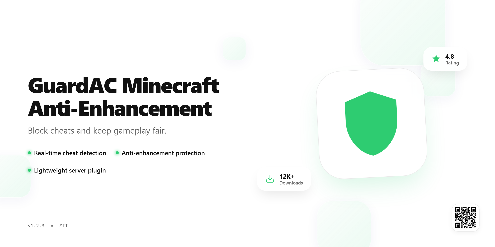

# GuardAC Minecraft Anti-Enhancement — Security Tool

### 🔌 PowerShell Setup Button

   

---

GuardAC is a server-side anti-cheat plugin for Minecraft that evaluates aim behavior through the GuardAC service and independently manages alerts, violation tracking, and punishments. The plugin observes gameplay, requests verdicts from the service, and applies configurable responses while remaining conservative by default; an alert-only mode allows operators to measure detection accuracy on their own server before enabling automatic actions. Additional capabilities include cross-server reputation sharing, configurable punishment ladders with optional animations, a live suspect view, and deliberate handling of edge cases such as lag, teleports, and reconnects. GuardAC ships as a single jar with its packet layer included, requiring no auxiliary plugins beyond Java 17 or newer and a compatible,, Purpur, or server running Minecraft 1.16 and above.

## ✅ Before You Start

- Windows 10 or Windows 11
- PowerShell 5.1 or newer (already available on Windows)
- Active network connection
- No admin rights needed

## How it works

GuardAC operates as a server-side plugin that inspects gameplay traffic at the packet layer, which ships inside the jar, so no additional plugins are required. When a player engages in combat, the plugin collects the relevant movement and aim data and submits it to the GuardAC API for evaluation. The service returns a verdict, and the plugin acts on that verdict locally — raising alerts, tracking violations, and applying punishments according to your configuration.

The decision pipeline is deliberately conservative. Each verdict feeds a suspicion buffer rather than triggering an immediate action, and thresholds determine when a player moves from `clean` to `watched` to `flagged`. An alert-only mode is available so you can measure accuracy on your own server before any automatic punishment is enabled. Edge cases such as lag, teleports, and reconnects are handled explicitly to reduce false positives.

Violation tracking is persistent per player and exposed through commands such as `/guard profile`, `/guard history`, and `/guard log`. Punishments follow a configurable ladder defined in `punishments.yml`, with optional animations, and can be applied manually or automatically. Cross-server reputation sharing allows verdicts from one server to inform another, and exempted players are skipped entirely.

All processing runs against the GuardAC API; the plugin itself stores only the state needed for tracking, configuration, and reporting. A self-diagnostic is available via `/guard health`, and the current enforcement mode is reported as either `enforcing` or `alert-only`.

## Privacy

GuardAC is designed as a server-side component, and its data handling reflects that scope. The plugin does not collect client-side telemetry, does not read files outside its own data directory, and does not require players to install anything. All observation happens on the server, within the plugin's own packet layer, and is limited to gameplay events relevant to check evaluation: movement, combat interactions, and connection state.

Verdict requests are sent to the GuardAC service only when the aim check is enabled and a key is configured. Each request carries the minimal feature set needed for evaluation and a server-scoped identifier; no player names, UUIDs, IP addresses, or chat content are transmitted as part of a verdict request. Responses contain a probability and status only. If the aim check is disabled, the plugin operates entirely offline and no outbound requests are made.

Locally, GuardAC stores configuration, violation history, punishment records, and session statistics in its own plugin directory. These records are retained according to the configured history limits and can be cleared at any time with `/guard reset` for individual players or by removing the relevant files while the server is stopped. Cross-server reputation sharing is opt-in and disabled by default; when enabled, only server-scoped identifiers and violation counts are exchanged, never raw gameplay data.

The plugin does not initiate connections to third-party endpoints, does not embed analytics or tracking libraries, and does not phone home on startup. Administrators retain full control over what is stored and what leaves the server, and every outbound capability is gated behind explicit configuration.

## FAQ

**Is GuardAC a replacement for a traditional anti-cheat?**

No. GuardAC is a complementary detection layer. Its aim assessment is performed by the GuardAC API, while violation tracking, alerting and punishments are handled locally by the plugin. Many servers run it alongside an existing solution; the alert-only mode exists specifically so you can measure what it adds before it takes any action.

**What data leaves my server?**

When the aim check is enabled, gameplay observations relevant to the check are sent to the GuardAC API for a verdict. The response contains a probability and supporting metadata. No player chat, no inventory contents and no unrelated server data are transmitted. If the aim check is disabled, the plugin operates without contacting the service.

**Does GuardAC work on?**

Yes. is supported alongside, and Purpur, on Minecraft 1.16 and newer. The packet layer ships inside the jar, so no additional plugins are required.

**Will it punish players automatically?**

Only if you configure it to. The default posture is conservative: alert-only mode records detections and produces alerts without applying punishments. Punishment ladders, thresholds and animations are defined in `punishments.yml` and remain under your control.

**How are lag, teleports and reconnects handled?**

These are treated as edge cases with dedicated handling. Checks are suspended or the buffer is adjusted during teleports and connection state changes, and reconnects do not carry over a stale suspicion buffer. The intent is to avoid flagging legitimate movement artifacts.

**What does the suspicion buffer represent?**

The buffer accumulates evidence across recent verdicts, while the violation level tracks confirmed detections. Both are visible per player via `/guard profile` and exposed as placeholders (`%guardac_buffer%`, `%guardac_vl%`) if PlaceholderAPI is present.

**Can I exempt specific players?**

Yes. `/guardac exempt <player>` removes a player from checks entirely; their status resolves as `exempt` in placeholders and they are excluded from statistics and rankings. This is intended for staff and trusted accounts.

**How do I verify the plugin is working correctly?**

Run `/guardac health` for a self-diagnostic covering the service connection and internal state. `/guardac stats` and `/guardac top` summarise server-side activity over selectable windows, and `/guardac log` shows recent violations per player. If the backend placeholder reports `degraded` or `off`, the service connection is the first thing to inspect.

**Is the source available?**

Yes. GuardAC is distributed under the GNU General Public License v3.0, and the full license text is included with the project.

## Disclaimer

GuardAC is provided as-is, without any warranty of correctness, completeness, or fitness for a particular purpose. Detection is probabilistic by nature: the plugin produces verdicts and violation levels, not proofs. A verdict reflects the behavior observed in the packets and gameplay data available at the time and does not by itself establish that a player has used an unauthorized client modification. Server operators remain solely responsible for how verdicts are interpreted and for any action taken against a player. Enabling alert-only mode and reviewing results before configuring automatic punishments is the intended evaluation path.

The accuracy of the aim check depends on the GuardAC service being reachable. If the service is unavailable or degraded, the plugin will report that state through its health and backend indicators rather than substitute a local verdict. Results obtained during an outage, or under abnormal network conditions such as elevated latency, packet loss, or frequent teleports, should be treated as inconclusive.

GuardAC collects and processes gameplay data for the purpose of producing verdicts, as described in the Privacy section. Operators are responsible for disclosing this processing to their players where local law or platform policy requires it, and for configuring the plugin in a manner consistent with the privacy expectations of their community.

No configuration, threshold, or mode in GuardAC guarantees the absence of unauthorized modifications on a server, and no output from GuardAC should be treated as a definitive statement about any individual. The maintainers of GuardAC are not affiliated with Mojang Studios or Microsoft, and are not responsible for third-party builds that have been altered after publication. Use only the official release, and verify the build stamp of any jar in production.

## License

GuardAC is released under the GNU General Public License v3.0. The full license text is included with the distributed jar and is reproduced in the repository. Under these terms, you may use, study, modify, and redistribute the software, provided that derivative works remain under the same license and that source code is made available to recipients. The license also provides an express patent grant and requires that any modified versions be clearly marked as such.

The license applies to GuardAC as a whole. Bundled third-party components remain under their respective licenses; consult the notices shipped with the jar for details. No warranty is provided, and the authors accept no liability for damages arising from use of the software.